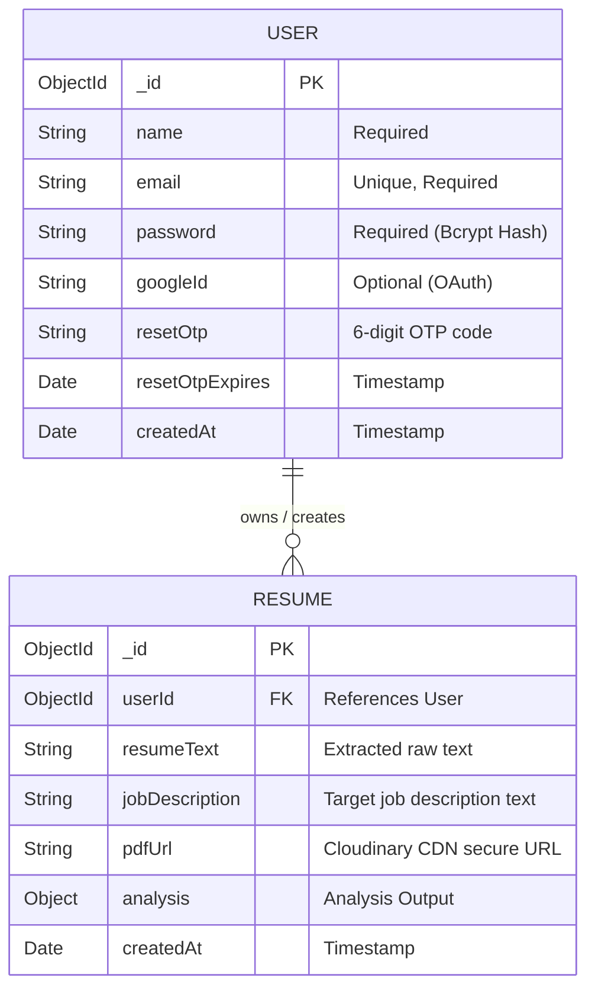
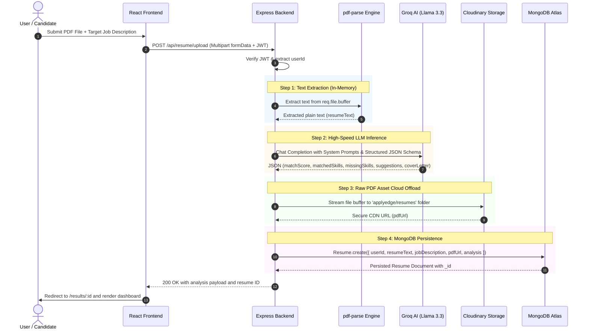
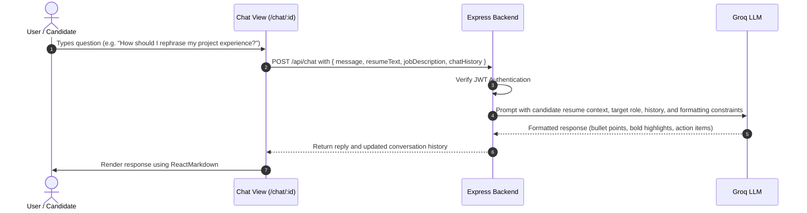
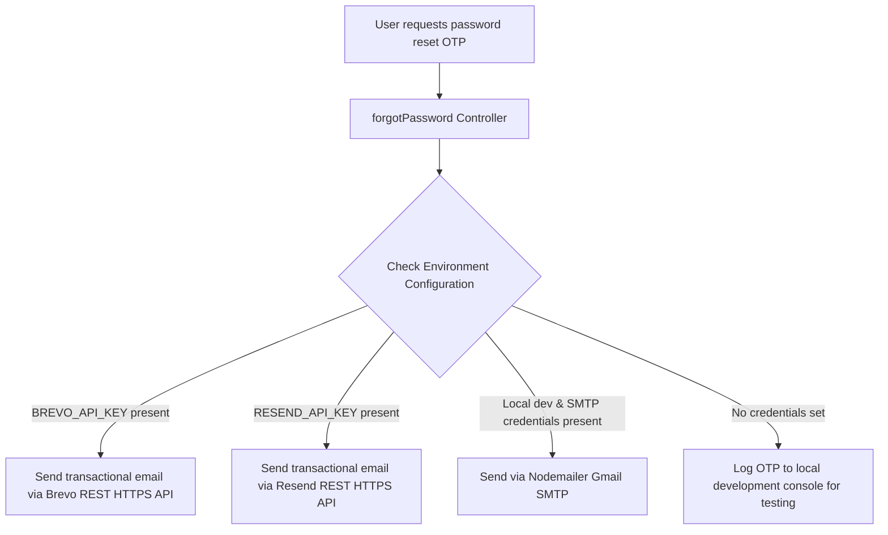

# ApplyEdge — System Architecture & Technical Design Document

## 1. Executive Summary

**ApplyEdge** is an AI-powered resume optimization and career preparation platform designed to help job candidates evaluate and tailor their resumes against specific job descriptions. By integrating large language models (LLMs) with automated document processing, ApplyEdge provides match scoring, identified skill gaps, actionable resume enhancement suggestions, tailored cover letter generation, and an interactive, context-aware AI career coaching assistant.

---

## 2. High-Level System Architecture

ApplyEdge adopts a decoupled client-server architecture with an asynchronous-capable API layer, cloud-managed persistence, external AI inference, and media asset storage.

```mermaid
flowchart TD
    subgraph ClientLayer ["Client Layer (Frontend)"]
        Browser["User Web Browser"]
        ReactApp["React 19 Single Page App\n(React Router v7, Tailwind CSS, Axios)"]
        Browser <--> ReactApp
    end

    subgraph Gateway ["Reverse Proxy / Gateway (Production / Docker)"]
        Nginx["Nginx Reverse Proxy / Static Host\n(Port 80 / 443)"]
    end

    subgraph BackendLayer ["Application Layer (Backend)"]
        ExpressApp["Express.js Server (Node.js runtime)\n(Port 5000)"]
        Router["Express Router\n(/api/auth, /api/resume, /api/chat)"]
        AuthMiddleware["JWT Authentication Middleware"]
        Multer["Multer Memory Buffer"]
        Controllers["Controllers\n(Auth, Resume, Chat, ForgotPassword)"]

        ExpressApp --> Router
        Router --> AuthMiddleware
        Router --> Multer
        Router --> Controllers
    end

    subgraph ExternalServices ["External Cloud Services & Integrations"]
        MongoDB[("MongoDB Atlas\n(Users & Resumes Data)")]
        GroqAI["Groq Cloud AI Engine\n(Llama 3.3 70B / Llama 4 Scout)"]
        Cloudinary["Cloudinary Storage\n(PDF Blob Storage)"]
        EmailService["Email Delivery\n(Brevo API / Gmail SMTP / Resend)"]
        GoogleOAuth["Google Cloud Identity\n(OAuth 2.0 Provider)"]
    end

    ReactApp -->|Proxy /api| Nginx
    Nginx -->|Proxy pass| ExpressApp
    ReactApp -.->|Direct API calls (CRA / Render)| ExpressApp

    Controllers <-->|Mongoose ODM| MongoDB
    Controllers <-->|Groq SDK| GroqAI
    Controllers <-->|Cloudinary SDK (Stream)| Cloudinary
    Controllers <-->|HTTPS API / SMTP| EmailService
    Controllers <-->|Passport OAuth 2.0| GoogleOAuth
```

---

## 3. Technology Stack Breakdown

| Component | Technology | Version / Spec | Purpose |
| :--- | :--- | :--- | :--- |
| **Frontend Framework** | React | 19.x | Component-driven Single Page Application (SPA) |
| **Routing** | React Router DOM | 7.x | Declarative client-side routing & navigation |
| **Styling** | Tailwind CSS | 3.4.x / PostCSS | Utility-first responsive styling and typography |
| **HTTP Client** | Axios | 1.16.x | Promise-based HTTP client with request interceptors |
| **Markdown Rendering** | react-markdown | 10.x | Formatting AI coach output & analysis insights |
| **Backend Runtime** | Node.js | >= 20.x | Non-blocking server-side execution environment |
| **Web Server Framework**| Express.js | 4.18.x | REST API routing, middleware, and request handling |
| **Authentication** | JSON Web Tokens (JWT) / Passport.js | `jsonwebtoken`, `passport-google-oauth20` | Bearer token authentication & Google federated OAuth |
| **Password Hashing** | bcryptjs | 3.x | One-way salt hashing for stored user passwords |
| **File Handling** | Multer | 1.4.x | In-memory multipart/form-data upload handling |
| **PDF Extraction** | pdf-parse | 2.4.x | Text extraction from in-memory PDF buffers |
| **Database** | MongoDB Atlas | Cloud Cluster | NoSQL document storage for users and analyses |
| **ODM** | Mongoose | 9.x | Schema validation and typed object modeling |
| **AI LLM Inference** | Groq SDK | `groq-sdk` / Llama 3.3 70B | High-throughput, low-latency resume evaluation |
| **Object Storage** | Cloudinary | v2 SDK | Secure CDN-backed storage for original uploaded PDFs |
| **Transactional Email** | Brevo API / Nodemailer | `nodemailer` | 6-digit OTP delivery for secure password reset |
| **Containerization** | Docker / Docker Compose | Multi-stage Dockerfile | Containerized local orchestration and Nginx serving |

---

## 4. Frontend Architecture

### 4.1 Directory Structure (`client/`)
```
client/
├── public/
│   ├── favicon.ico
│   ├── index.html
│   └── manifest.json
├── src/
│   ├── components/
│   │   └── Navbar.jsx         # Global top navigation bar with dynamic auth state
│   ├── pages/
│   │   ├── Landing.jsx        # Marketing page with platform highlights & CTA
│   │   ├── Login.jsx          # Traditional email/password login & Google OAuth trigger
│   │   ├── Register.jsx       # User registration screen
│   │   ├── ForgotPassword.jsx # 3-stage OTP recovery (Email -> Verify OTP -> Set Password)
│   │   ├── AuthSuccess.jsx    # OAuth redirect receiver (extracts token & user payload)
│   │   ├── Analyze.jsx        # Resume upload, job description input, and history selector
│   │   ├── Results.jsx        # Visual analysis dashboard (Match score, skill badges, cover letter)
│   │   └── Chat.jsx           # AI career coaching chat interface with formatted Markdown
│   ├── utils/
│   │   └── api.js             # Configured Axios instance with auto-bearer auth injection
│   ├── App.js                 # Route registry and application scaffolding
│   ├── index.js               # React 19 root bootstrap
│   └── index.css              # Tailwind base imports and global styles
├── nginx.conf                 # SPA fallback configuration for standalone deployments
├── nginx.docker.conf          # Reverse proxy configuration routing /api to backend service
├── package.json
└── tailwind.config.js
```

### 4.2 Client-Side Routing and Flow
The client routing table configured in `App.js` manages access to views:
- `/` &rarr; `Landing`: Public landing page.
- `/login`, `/register` &rarr; `Login`, `Register`: Authentication pages.
- `/forgot-password` &rarr; `ForgotPassword`: Self-service password recovery flow with countdown timer.
- `/auth/success` &rarr; `AuthSuccess`: Handles token ingestion following Google OAuth redirection.
- `/analyze` &rarr; `Analyze`: Core workbench; allows PDF upload or selection of past uploaded resumes.
- `/results/:id` &rarr; `Results`: Comprehensive analytics page showing match score, missing skills, suggestions, and generated cover letter.
- `/chat/:id` &rarr; `Chat`: Interactive career coach chat grounded in the specific resume and job description.

### 4.3 API Communication Layer (`client/src/utils/api.js`)
- Dynamically resolves API base paths:
  - Development: Proxying through CRA `package.json` (`http://localhost:5000`).
  - Production (Render): Explicit `REACT_APP_API_URL` pointing directly to the backend URL.
  - Docker: Relative `/api` paths routed by Nginx.
- **Request Interceptor**: Inspects `localStorage` for `token` and injects `Authorization: Bearer <token>` on all outbound HTTP requests automatically.

---

## 5. Backend Architecture

### 5.1 Directory Structure (`src/`)
```
src/
├── config/
│   ├── cloudinary.js          # Cloudinary SDK credentials initialization
│   ├── database.js            # Mongoose MongoDB Atlas connection manager
│   ├── email.js               # Multi-provider email dispatcher (Brevo HTTPS API & SMTP)
│   ├── groq.js                # Groq AI client configuration & model selection
│   └── passport.js            # Google OAuth 2.0 passport strategy configuration
├── controllers/
│   ├── authController.js      # User registration, credential validation & JWT generation
│   ├── chatController.js      # Grounded LLM conversation engine for career coaching
│   ├── forgotPasswordController.js # OTP generation, verification, and password updates
│   └── resumeController.js    # PDF parsing, AI analysis pipeline, history retrieval
├── middleware/
│   └── auth.js                # JWT verification & `req.userId` context injection
├── models/
│   ├── Resume.js              # Mongoose schema for resume analysis records
│   └── User.js                # Mongoose schema for user accounts & password reset tokens
├── routes/
│   ├── auth.js                # Auth endpoints (/register, /login, /forgot-password, /google)
│   ├── chat.js                # Chat endpoint (/api/chat)
│   └── resume.js              # Resume endpoints (/upload, /results/:id, /history, /analyze-existing)
└── index.js                   # Application bootstrap, CORS, session, and route binding
```

### 5.2 Core API Endpoints

| Route | HTTP | Auth | Payload / Params | Functionality |
| :--- | :---: | :---: | :--- | :--- |
| `/health` | GET | None | None | Application health check and environment status |
| `/api/auth/register` | POST | None | `{ name, email, password }` | Creates new user with bcrypt-hashed password |
| `/api/auth/login` | POST | None | `{ email, password }` | Authenticates credentials; returns signed JWT |
| `/api/auth/google` | GET | None | Query params | Initiates Google OAuth consent screen |
| `/api/auth/google/callback` | GET | None | OAuth tokens from Google | Completes OAuth; redirects to frontend `/auth/success` |
| `/api/auth/forgot-password` | POST | None | `{ email }` | Generates 6-digit OTP and dispatches email |
| `/api/auth/verify-otp` | POST | None | `{ email, otp }` | Validates active, non-expired OTP |
| `/api/auth/reset-password` | POST | None | `{ email, otp, newPassword }` | Commits new bcrypt password hash to database |
| `/api/resume/upload` | POST | JWT | `multipart/form-data` (file + `jobDescription`) | In-memory text extraction, AI scoring, Cloudinary upload & DB save |
| `/api/resume/results/:id` | GET | JWT | `:id` (resume document ID) | Fetches complete analysis record |
| `/api/resume/history` | GET | JWT | None | Lists past resumes for authenticated user |
| `/api/resume/analyze-existing` | POST | JWT | `{ resumeId, jobDescription }` | Re-evaluates saved resume text against new job description |
| `/api/chat` | POST | JWT | `{ message, resumeText, jobDescription, chatHistory }` | Conversational career coach grounded in candidate context |

---

## 6. Database Schema & Data Models

The persistence layer uses MongoDB with Mongoose ODM schemas.



### Analysis Nested Structure:
```json
{
  "matchScore": 85,
  "matchedSkills": ["JavaScript", "React", "Node.js", "REST APIs"],
  "missingSkills": ["Docker", "Kubernetes", "GraphQL"],
  "suggestions": [
    "Highlight experience with containerization tools in recent projects.",
    "Quantify impact with measurable metrics in the experience section.",
    "Mention automated unit testing frameworks (Jest/Mocha)."
  ],
  "coverLetter": "Dear Hiring Manager,\n\nI am writing to express my enthusiasm for the Software Engineer role..."
}
```

---

## 7. Key Operational Workflows

### 7.1 Resume Upload & AI Analysis Pipeline
To optimize response latency and safeguard against cloud proxy timeouts (e.g., Render 30-second request bounds), the upload pipeline is organized in sequential stages:



---

### 7.2 Interactive AI Career Coaching
Users can engage in an ongoing conversation with an AI career coach about their analysis:



---

### 7.3 Multi-Provider Password Recovery Flow
To prevent free-tier cloud host SMTP blocks (such as Render blocking ports 587 and 465), ApplyEdge implements a resilient multi-tier delivery strategy:



---

## 8. Deployment & Infrastructure Architecture

ApplyEdge supports three deployment paradigms:

### 8.1 Local Multi-Process Development
- **Backend**: Executed with `nodemon src/index.js` or `node src/index.js` on port `5000`.
- **Frontend**: Executed with `react-scripts start` on port `3000`. Requests to `/api/*` are forwarded to port `5000` via CRA's built-in development proxy.

### 8.2 Containerized Orchestration (`docker-compose.yml`)
- **Backend Container (`applyedge-backend`)**:
  - Based on `node:20-alpine`.
  - Runs Express API on port `5000`.
  - Connects to external MongoDB Atlas and cloud APIs.
- **Frontend Container (`applyedge-frontend`)**:
  - Multi-stage build: Stage 1 builds React production bundles with `node:20-alpine`; Stage 2 serves assets through `nginx:alpine` on port `80`.
  - `nginx.docker.conf` proxies `/api/` traffic internally to `http://backend:5000/api/` and routes client routes to `index.html`.

### 8.3 Cloud Deployment (Render Blueprint)
Configured in `render.yaml`:
- **Web Service (`applyedge-api`)**: Native Node.js web service running `npm install && npm start`.
- **Static Site (`applyedge-web`)**: Pre-built static site running `npm install && npm run build` in `client/`, configured with SPA fallback rewrite rules.

---

## 9. Security & Resilience Architecture

1. **Defense-in-Depth Authentication**:
   - Passwords hashed with bcrypt (salt rounds = 10).
   - Sessionless stateless JSON Web Tokens (7-day validity).
   - Protected routes guarded by `authMiddleware` reading `Authorization: Bearer <token>`.
2. **Buffer Security & Memory Storage**:
   - Files are stored in temporary RAM buffers (`multer.memoryStorage()`) during request processing. No temporary disk files are created or orphaned.
3. **API & Cloud Timeout Mitigations**:
   - PDF text extraction runs first, followed by Groq AI analysis, before long-running Cloudinary asset streaming occurs.
   - Client-side Axios timeout extended to 120 seconds to prevent network aborts during AI generation spikes.
4. **Resilient DNS & Network Configuration**:
   - Express sets `dns.setDefaultResultOrder('ipv4first')` to eliminate IPv6 network reachability issues (`ENETUNREACH`) common in Docker bridge environments.
   - Reverse proxy compatibility enabled with `app.set('trust proxy', 1)`.

---

## 10. Execution & Run Guide

### 10.1 Environment Configuration
Create a `.env` file in the project root:
```env
# Application
NODE_ENV=development
PORT=5000
CLIENT_URL=http://localhost:3000
SERVER_URL=http://localhost:5000

# MongoDB Atlas
MONGODB_URI=mongodb+srv://<username>:<password>@cluster.mongodb.net/applyedge

# Secrets
JWT_SECRET=your_super_secret_jwt_key_here_32_chars_min
SESSION_SECRET=your_super_secret_session_key_here

# Groq Cloud
GROQ_API_KEY=gsk_your_groq_api_key
GROQ_MODEL=llama-3.3-70b-versatile

# Cloudinary
CLOUDINARY_CLOUD_NAME=your_cloud_name
CLOUDINARY_API_KEY=your_cloudinary_key
CLOUDINARY_API_SECRET=your_cloudinary_secret

# Optional Email / OAuth
BREVO_API_KEY=
BREVO_SENDER_EMAIL=
GOOGLE_CLIENT_ID=
GOOGLE_CLIENT_SECRET=
```

### 10.2 Starting the Servers Locally

**Backend Service:**
```bash
# In the root project directory
npm install
npm run dev # or npm start
# API starts on http://localhost:5000
```

**Frontend Service:**
```bash
# In the client directory
cd client
npm install --legacy-peer-deps
npm start
# Client web application opens at http://localhost:3000
```
